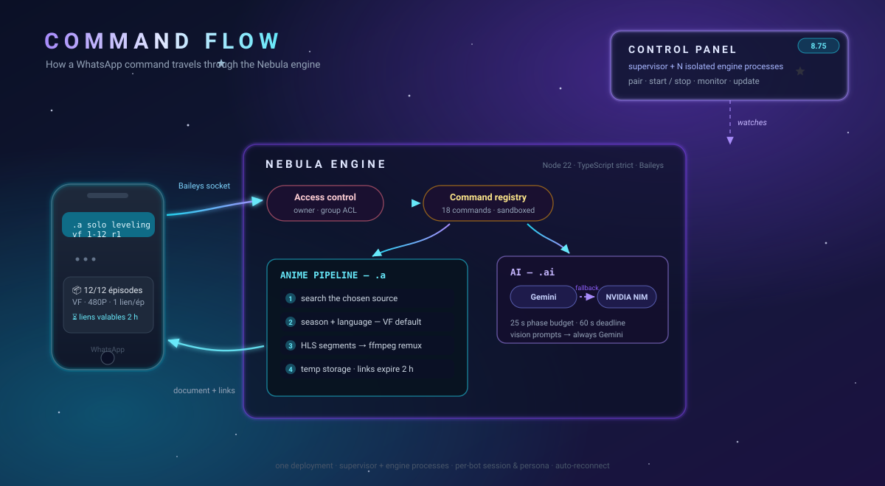
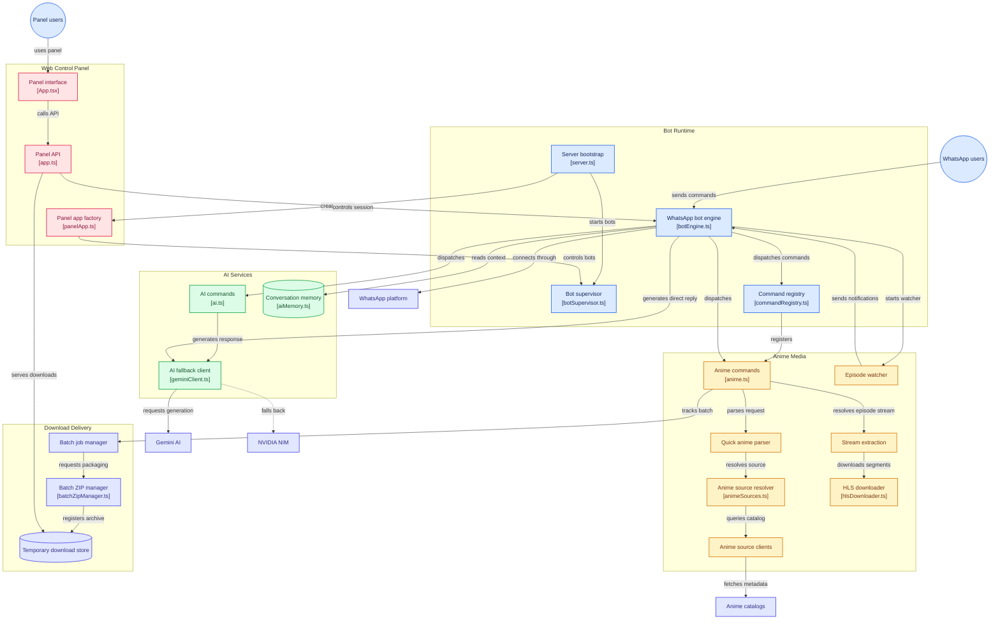

<div align="center">

<h1>
  <picture>
    <source media="(prefers-color-scheme: dark)" srcset="docs/brand/logo-horizontal-on-dark.svg">
    
  </picture>
</h1>

**WhatsApp Media &amp; AI Command Center** — anime VF downloader, an autonomous AI agent that runs the bot for you, YouTube/TikTok/Instagram, temporary share links, multi-bot and a full web control panel. One container, one command.

[](https://github.com/JCVERSA/p/actions/workflows/ci.yml)
[](#-tests)
[](./tsconfig.json)
[](https://nodejs.org)
[](https://github.com/WhiskeySockets/Baileys)
[](https://ffmpeg.org)
[](./app.ts)
[](./package.json)
[](./LICENSE)

[What you get](#-what-you-get) · [Quick start](#-quick-start) · [Commands](#-commands) · [AI agent](#-the-ai-agent) · [Anime engine](#-anime-engine) · [Architecture](#%EF%B8%8F-architecture) · [Env](#-environment-variables) · [Docs](#-documentation)

</div>

---

## ✨ What you get

- **Ask twice, download once.** A 24-hour reuse cache (9.15) keyed by the exact media identity — anime/season/episode/language/resolution, or YouTube video/quality/audio-track/subtitles — serves any repeat request (even from another user) with an instant link on the already-downloaded file: zero re-download, zero bandwidth, zero extra disk (hard links). LRU-evicted under its own 1 GiB cap, never deletes a file a live link is serving, and `.up` private uploads are excluded by design.
- **Anime in French, zero babysitting.** VF by default (quick *and* interactive flows) from `voir-anime.to` with a VOSTFR fallback catalog, honest « VF non disponible » when a title has no dub, seasons batch-downloaded as one offline HTML page of direct links, new-episode watchers that DM you the ready-made command, and screenshot identification via trace.moe.
- **An agent that actually runs the bot.** Write naturally — in DMs, or in groups with an @mention or a reply to the bot — and the AI agent translates it into the exact registered command and executes it at *your* rights, with fail-closed confirmations for heavy actions, a 3-decision bounded loop that drives interactive screens to completion, and a 10-minute observation memory so « le 2e » just works. General group chatter never triggers an AI turn.
- **Talk to it.** Send a voice note in DM (or @mention the bot in a group) — it's transcribed (NVIDIA NIM Whisper, same key as the AI fallback) and handled exactly like text: « télécharge l'épisode 5 de jjk » spoken becomes the ready link. 10 transcriptions/hour/user, honest failure messages, nothing stored.
- **Every downloader a WhatsApp group needs.** YouTube videos (French audio track by default on dubbed videos, auto subtitles, playlists up to 25 delivered as one page), TikTok without watermark, Instagram posts (up to 20 media), Cameroon GCE past papers as PDFs — and `.up` turns any file into a temporary share link.
- **Honest delivery, honest labels.** Real resolutions and sizes (a fat 403 MB « 480P » is auto-downgraded), files slimmed at the *same* resolution when heavy, per-episode failures reported, links with sliding TTL — never a lie in a caption.
- **Fleet-ready.** Up to 8 WhatsApp bots in one deployment (per-bot process, session and persona), each linked by QR **or** 8-digit pairing code with auto-reconnect and bad-session recovery, a web control panel with live simulator, secrets manager, env editor, log tail and one-click updates, plus a daily owner digest.
- **Runs on one small VPS.** Container-first (1 GB): sequential batches, disk-streamed segments, streaming ZIP writer, capped heap, cross-bot disk guards. `./manage.sh doctor` should end with *RIEN DE BLOQUANT*.

## 📸 What it looks like

Real bot output (VF by default, one high-speed link per episode, honest size labels):

```text
.a sparks of tomorrow s1 1-12 r1

📦 Nebula Novabox - Batch Media Preparation 🚀
🎬 Anime: Sparks of Tomorrow
🗣️ Language: VF          ← French dub by default (VOSTFR on request)
⚙️ Resolution: 480P
📦 Episodes to Process: 9

🚀 NEBULA NOVABOX - BATCH DOWNLOAD COMPLETED 🚀
📦 Ready Episodes: 9/9          ⏳ Links Validity: 2 Hours
📥 Direct Episode Links:
• 🎬 Episode 1: [88.93 MB]   🔗 https://your-domain/api/media/download/<token>
• 🎬 Episode 2: [89.84 MB]   🔗 …
```

The interactive flow defaults to VF too — and never lies about the language actually delivered:

```text
🎬 Novabox - Select Season 🎬
• Anime: Tomb Raider King
• Language: 🇫🇷 VF (Default)
💡 (Pour passer en VOSTFR, tape `.a vostfr`)
```

And the agent drives the whole thing from one natural-language message:

```text
You: télécharge mushoku tensei saison 3 épisode 12 en 480p
Bot: 🎬 Lien prêt — Épisode 12 [92.4 MB] 🔗 https://…
```

## 🚀 Quick Start

### On a VPS (recommended — one line)

```bash
curl -fsSL "https://raw.githubusercontent.com/JCVERSA/nebula-p/main/scripts/install.sh" | sh
```

This installs dependencies (git, Node ≥ 22, ffmpeg), clones the repo, builds it,
creates the `nebula` command available everywhere and offers the `.env` wizard.
Then:

```bash
nebula env        # APP_URL, PANEL_TOKEN, GEMINI_API_KEY… (if not done yet)
nebula start      # start + wait for the panel
```

The installer is idempotent — running it again just updates the installation.
Manual equivalent: `git clone -b main https://github.com/JCVERSA/nebula-p /root/p && cd /root/p && ./manage.sh setup`.

Then put it behind HTTPS with a Cloudflare Tunnel and set `APP_URL` —
see **[docs/MIGRATION_NOUVEAU_VPS.md](docs/MIGRATION_NOUVEAU_VPS.md)** (French, step-by-step).

Tip: `alias nebula='bash /root/p/manage.sh'` — then everything is `nebula <command>`.

### Local development

```bash
npm install
npm run dev        # panel at http://localhost:3000
```

Requirements: **Node.js ≥ 22** and `ffmpeg` on PATH for media.

### Day-to-day operations

| Command | What it does |
|---|---|
| `./manage.sh start / stop / restart` | Lifecycle; start waits for the panel and tails the log on failure |
| `./manage.sh update` | `git pull --ff-only` → `npm install` (only if deps changed) → build → restart |
| `./manage.sh status` | Process RAM vs cgroup cap, panel + public URL probes, temp usage, disk |
| `./manage.sh logs [filter]` | Live log tail, optionally filtered (e.g. `logs NOVABOX`) |
| `./manage.sh env` | Interactive `.env` wizard — 37 documented keys, secrets masked |
| `./manage.sh doctor` | Full diagnostic: node/ffmpeg/.env/RAM/disk/network, exit 1 on blockers |
| `./manage.sh clean` | Purges orphan staging (>1h) and expired temp files (>3h) |
| `./manage.sh pair [bot] <phone>` | Links a WhatsApp number with an 8-digit pairing code (no QR needed) |
| `./manage.sh bots` | Multi-bots overview: per-bot process + WhatsApp state (8.75) |
| `./manage.sh bot <id> <start/stop/restart/status>` | Controls one bot's engine process |

## 🧩 Commands

Curated by owner decision (8.59) — the inventory is **locked by a registry test**; the legacy corpus, its CJS bridge, the media toolkit, moderation suite and coin system were removed.

| Command | What it does |
|---|---|
| `.a <titre> [épisodes] [r1-r4] [vf\|vostfr]` | Anime downloader — VF by default, batch ranges, batch pages, `.a watch` new-episode watcher, `.a as` full catalog |
| `.ytv <nom ou lien> [360-1080] [vo] [playlist]` | YouTube video — French audio track by default, auto subtitles, playlists up to 25 |
| `.ytm` / `.yts` | YouTube audio (AAC) / search links |
| `.tiktok` / `.instagram` | No-watermark TikTok / up to 20 media per Instagram post |
| `.up` (alias `.upload .tr .lu .opload .opl .upl`) | Any file (attached or quoted) → temporary share link |
| `.w` | Episode watch management |
| `.search [-d/-w/-m/-y]` / `.fetch <url>` / `.wiki` | Web results (keyless DDG, optional Tavily) / read a page as clean text / French Wikipedia — zero AI tokens |
| `.ai` / `.image` | AI chat — defined persona (overridable via `NEBULA_AI_PERSONALITY`), per-conversation memory (`.ai forget`), audio transcription, TTS voice conversations; NVIDIA NIM fallback keeps it alive through Gemini outages — / image generation |
| `.agent` / `.ag` | The AI agent on demand (in DMs it's automatic — see below) |
| `.define` / `.gce` (`.g`) / `.qr` / `.base64` / `.sweb` / `.getpp` / `.whois` / `.trace` | Dictionary · Cameroon GCE past papers as PDFs (O/L, A/L, mocks) · QR codes · base64 · website screenshot · profile pics · WhatsApp user info · identify an anime from a screenshot |
| `.ping` / `.menu` / `.help` | Liveness · command menu |
| `.purge` / `.p` *(owner)* | Immediate disk purge sparing in-flight batches |
| *(panel-created)* | Sandboxed commands created from the web panel — `vm` with no fs/process/network, no restart |

## 🤖 The AI agent

The agent (9.1–9.12) is the bot's nervous system: it knows **every registered command** (auto-synced with the registry, panel commands included, under a CI-enforced context budget) and turns natural language into the exact command, executed **at the requesting user's own rights** — RoleGuard unchanged.

- **Where it listens:** any non-prefix message in DMs; in groups, only messages that address the bot (an @mention or a reply to a bot message) — general chatter never costs a token.
- **The bounded loop:** max 3 AI decisions per message; the agent *observes* what commands reply (selection lists, season/quality pickers) for 10 minutes and drives them to completion; a bare « 1 »/« 2 » answer to a pending `.ytv` screen is routed straight to the command **without an AI turn**; per-user pending choices (no cross-consumption in groups).
- **Safety model** (documented in [SAFETY.md](SAFETY.md)): zero-trust validation, denylist, argument guardrail, **fail-closed confirmations** for heavy actions (batch downloads, playlists), separate agent budget (10/h), anti-loop signature guard, full audit trail, per-turn metrics on the panel's « AI Agent » card + a daily owner digest. Replay harness: `npm run agent-replay`.
- **Context awareness:** media hints (joint or quoted media), quoted message text (links, titles), voice notes (transcribed then handled like text — 9.13), anime history when the message is about anime, honest failures with command suggestions (« voulais-tu dire `.menu` ? »). Repetitive command output (progress lines) is compacted before entering the agent's context — token-lean by design.

<details>
<summary><strong>Engineering log — release notes 8.x–9.x (every fix, root cause first)</strong></summary>

- **Download links are always absolute (9.15b)** — owner report: links opened as `file:///C:/.../transfers/dash2.../api/media/download/<token>` instead of downloading. Root cause: an `APP_URL` edited without its `https://` scheme made every generated link scheme-less, and a scheme-less link inside the delivered HTML page (which WhatsApp Desktop saves into its `transfers` folder) resolves as a RELATIVE local path — nothing can download; the same flaw silently disabled the Host-header guard (`new URL()` threw on the scheme-less value). Fix at three levels, all self-healing without touching `.env`: `getServerBaseUrl()`/`updateServerBaseUrl()` now normalize the base (https:// prepended when missing, trailing slashes trimmed — pure `normalizePublicBaseUrl`, reused by the Host guard so it comes back to life), and the download page absolutizes every entry URL before rendering (href + the download-all engine's list), so even a page produced with a broken base still works.
- **Media reuse cache (9.15)** — owner idea: user A downloads episodes 1-9, user B asks for episode 4 → B gets an instant link on A's file instead of a re-download. A new service (`mediaReuseStore`) keys already-delivered public media by its logical identity (anime: normalized title+season+episode+language+resolution; YouTube: video id+quality+audio track+subtitles), stores them as HARD LINKS in a dedicated dir (same filesystem as staging — zero extra bytes, and the file survives the temp vault's move), and serves hits by minting a no-copy vault token directly on the cached file. Window: 24 h sliding (every hit refreshes), cap 1 GiB with LRU eviction that NEVER deletes a file a live vault link is serving (checked via the vault's records). Honesty/safety: a hit requires the file to exist and be non-empty (missing → self-heal + normal re-download path, never a user-visible error); `NEBULA_REUSE_ENABLED=0` cuts everything; `.purge` also clears the cache; private `.up` uploads never enter it (only the anime and YouTube pipelines insert); the ytv cleanup finally-block is guarded so a cache hit can never delete the shared file. Cross-catalog fallback means the same key may be filled from either catalog — same episode, honest labels.
- **Download pages restyled with the file-share design language (9.14)** — owner decision after reviewing [JCVERSA/file-share](https://github.com/JCVERSA/file-share): the offline batch/playlist HTML page (animes, `.ytv` playlists) now wears file-share's visual identity — dark mint/teal palette, shell + topbar with a live status pill (« liens actifs · expire dans X min »), per-file tiles (MP4/ZIP/PDF), restrained hovers, tabular-nums — and its animations: skeleton shimmer, spinner in the « Tout télécharger » button, animated check on completed rows, `prefers-reduced-motion` respected. The skeleton is not decoration: on load the page sweeps every link with the existing HEAD probe, so an expired link (410/404) now shows BEFORE any click — and the sweep never overwrites a row the user already handled. All 8.41 hardening intact (no navigation on dead links, honest states, anti-`</script>` escaping), still a single self-contained file under 13 KB.
- **Voice notes → agent + leaner observation memory (9.13)** — two additions inspired by free-claude-code's audit: (1) a voice note addressed to the bot (DM always; groups only on @mention/reply-to-bot — the same 9.11 addressing gate) is downloaded, converted by ffmpeg to 16 kHz mono wav and transcribed through NVIDIA NIM's OpenAI-compatible `/audio/transcriptions` endpoint (the same key as the AI fallback — no new dependency); the transcript becomes the agent's message, the agent is told it's transcribed speech, and a « recording » presence shows while it works. Guards: enabled only when the NIM key exists (`NEBULA_ASR_ENABLED=0` cuts it), a dedicated 10/hour/user budget (failures are never charged), 16 MB input cap, 30 s timeout, and every failure mode answers honestly (disabled, budget, model unavailable — the error names `NEBULA_ASR_MODEL` and build.nvidia.com —, ffmpeg missing, empty transcript) instead of silently starting an AI turn on empty text; when the agent itself is disabled the raw transcript is still replied. (2) `setLastObservation` now compacts repetitive command output before storing it — a 12-line « ⏳ Épisode N/12 » progress becomes 2 lines + an honest marker + the last 2, keeping interactive selection screens (short, or with genuinely distinct lines) intact.
- **Pending .ytv choices scoped per user (9.12)** — reopened audit item B5, made relevant by 9.11's group activation: pending `.ytv` choices (video/playlist 1-2, audio track number) were keyed by CHAT, so in a group two members starting `.ytv` simultaneously would overwrite each other's choice and any member's « 1 » could consume another's download. The key is now `(chat, author)` — `DispatchInfo.actorJid` (the real participant in groups, = chat in DM) travels down to the command context (`senderUser`), so each user owns their pending screen; DM behavior is unchanged. Flow decision: a bare « 1 »/« 2 »/« video »/« playlist » from a user with a fresh pending choice is routed straight to `.ytv` WITHOUT an AI turn (both in DM — like the novabox language confirm before it — and in groups, where a bare number would otherwise be ignored since 9.11, making the « Réponds avec 1 ou 2 » instruction a lie); the agent's pending heavy confirmation still takes priority when both exist. And an orphan choice answer — `.ytv 1` with no pending choice for THAT user (another group member, expired 10-min TTL…) — now gets an honest « ❓ Aucun choix en attente pour toi » instead of literally searching YouTube for « 1 » (the residual B3 symptom). The agent's observation memory stays per-chat on purpose (it reflects what the chat SAW); anime history (8.97) also stays per-chat — in a group, « l'épisode suivant » referring to the conversation's last download is a feature.
- **Agent audit fixes + groups (9.11)** — the full agent audit (runner, brain, observation, dispatch, engine) confirmed the solid core (zero-trust validation, budgets, anti-loop, fail-closed confirmations) and fixed four UX bugs: **B1** a typo'd prefix command (`.menue`) was answered with total silence — the dispatcher now suggests the closest command (« ❓ Commande inconnue — voulais-tu dire `.menu` ? », Levenshtein ≤ 2 on names + aliases, exact alias → canonical, and the agent's honest failure message carries the same suggestion); **B2** `.ytv <lien> playlist` wasn't classified heavy — it is now (up to 25 videos, 2 GB), so the agent asks for confirmation first, same as `.a 1-5`; **B3** the pending `.ytv` choice TTL was 3 min while the agent's observation memory lasts 10 — between the two, « 1 » was read as a YouTube search for the word « 1 »; both are now 10 min; **B4** replying to a text message (e.g. one containing a link) was invisible to the agent — the quoted message's text (up to 200 chars, unwrapped through all wrapper layers, registry fallback by `stanzaId`) is now part of the agent's context (« ## Message cité »), so « télécharge ça » in reply to a link just works. And the big one — **the agent now answers in GROUPS too (M1)**: a group message wakes the agent ONLY when it addresses the bot (an @mention of the bot or a reply to one of the bot's messages — `messageAddressesBot`, number-normalized comparison against `sock.user.id`); general group chatter never triggers an AI turn (token cost), and all existing guards apply unchanged (budgets, denylist, heavy confirmations). Not retained from the audit: B5 (per-chat pending-choice scoping), M2 (per-chat turn lock), M3 (turn memory records the executed command's summary).
- **YouTube audio tracks, subtitles & playlists (9.10)** — `.ytv` now probes the video before downloading: multi-dubbed videos get the FRENCH audio track by default (`.ytv <lien> vo` lists the available tracks and you pick a number; an explicit code like `ja` works too), and subtitles are embedded automatically when they exist (manual FR first, then auto-FR, then EN — mov_text, toggleable in VLC; WhatsApp's built-in player ignores them, VLC doesn't). A link containing a playlist now asks « 1. cette vidéo seule / 2. la playlist entière » (or force it with `playlist`/`video` keywords); playlists download up to 25 videos (honest truncation note beyond), each slimmed per 9.7 when heavy, delivered as the proven offline HTML page with per-video buttons + « Tout télécharger », optional ZIP behind `NEBULA_BATCH_ZIP=1`, a 2 GB cumulative guard, and per-video failures reported honestly. Playlist progress shows in the dashboard batch jobs. Failed probes degrade to the pre-9.10 behavior — never an exception.
- **Organized VF selection + VOSTFR routing (9.9)** — owner decision: a default `.a <title>` search now shows ONLY the VF entries, organized per anime: seasons grouped and labeled (« Kimetsu no Yaiba — Saison 2/3/4 » — the site publishes one page per season, which used to read as different animes), films named (« — Film : Mugen Ressha-hen »), and subtitled entries without a structural season marker keep their full title (never an invented « Saison 1 »). An explicit VOSTFR request (`.a <titre> vostfr`) now goes straight to the fallback catalog instead of detouring through the VF one. The agent's `.a` knowledge was updated to match (private source names stay out of the user-facing fiche, per 8.42).
- **Stripped-quote replies + prefix observations (9.8)** — the `.up` reply diagnostic finally named the last resistant shape: `extendedTextMessage + messageContextInfo` — a reply whose quoted content WhatsApp deliberately omits (disappearing-message chats quoting an already-vanished message). The stanzaId still identifies the original, so a bounded in-memory registry of recent messages (last 400, 2 h TTL, received AND bot-sent) now resolves the media by ID when the quote is empty — for the command AND for the agent's media hint. Second production fix in the same train: interactive screens produced by PREFIX commands (`.a demon slayer` typed directly) were not memorized as observations, so a bare « 3 » after the selection list made the agent ask a question instead of running `.a 3` — every command output is now recorded (the agent path was already covered).
- **Video slimming — same resolution (9.7)** — owner-reported pain: a 1080p episode weighs ~400 MB. Videos and episodes above `NEBULA_SLIM_MAX_MB` (default 200 MB, dashboard-editable 50-2000) are now re-encoded in place with x264 at the SAME resolution: quality-first CRF bounded by a deterministic bitrate ceiling (the proven WhatsApp-fit pattern, minus the 480p downscale). Guardrails: a failed/timed-out/counterproductive encode always delivers the ORIGINAL file, only ONE encode runs at a time (1 GB VPS), unknown duration or no possible gain skips entirely, and the file is replaced on disk so every downstream link/label shows the real size. GitHub research behind the choices: compression bots get big ratios only by sacrificing resolution (forced 480p) or using H.265 — both refused here (H.264 plays everywhere, cf. the VP9 incident); pro per-title CRF search (VMAF) costs more CPU than the encode itself. For `.ytv` this also means videos up to 400 MB are now downloaded then slimmed under the 100 MB send cap instead of being refused.
- **Agent media awareness + .up reply fix (9.6b/9.6c)** — production transcript: « je veux un lien » + a reply to a video took FOUR clarification questions and then `.up` answered « Aucun fichier détecté ». Fixes: (1) media extraction now uses Baileys' own `normalizeMessageContent` — the official unwrapper knows NINE wrapper layers (ephemeral, viewOnce v1/v2/v2Extension, documentWithCaption, editedMessage, associatedChildMessage, groupStatus…) where the hand-rolled one knew four and only checked the first object key, which is exactly why the agent could SEE the quoted video (9.6b hint) while the command could not; (2) the agent receives a one-line media hint when the user's message attaches or quotes media (« répond (reply) à une vidéo » — nature only, never the content), so « un lien pour ça » resolves straight to `.up`; (3) when `.up` finds no media it now logs the message's top-level KEYS (never the content) — any resistant shape names itself in the dashboard journal immediately.
- **YouTube hardening (9.6)** — three production-driven changes: (1) downloads now prefer **H.264+AAC** (real mp4 — "best video" is VP9/AV1 remuxed into an .mp4 container, which WhatsApp and Windows players refuse with « souci avec le fichier vidéo »; YouTube serves avc1 up to 1080p, old behavior kept as fallback); (2) the session cookies are only attached as a **fallback** when a video demands sign-in — anonymous first, so the authenticated volume (what Google actually watches from a datacenter IP) drops to the strict minimum, with a global cap of 50 session downloads/hour (honest refusal beyond; anonymous stays unlimited); (3) `nebula update` now **self-updates the yt-dlp binary** (stale versions trigger more bot checks). Best practices remain: use a throwaway Google account, never the personal one, and only from the VPS.
- **YouTube cookies pasted in the dashboard (9.4)** — the Système section now takes the cookies.txt *content* directly: paste the file exported by "Get cookies.txt LOCALLY" from a signed-in youtube.com, and the panel validates it (strict Netscape format, at least one youtube.com cookie, not already expired), writes it atomically with 0600 perms, auto-configures `NEBULA_YTDLP_COOKIES` and shows a full diagnostic (cookie count, domains, furthest expiry date). Replacing the file applies hot (no restart); only the first setup needs one. A delete button reverts to anonymous mode. The cookie content is never displayed nor returned by the API — write-only, like the API keys.
- **.env editor in the dashboard + agent honesty fixes (9.3)** — the Système section now edits a whitelisted set of `.env` variables directly from the panel (AI/web quotas, primary engine, digest on/off & hour, timezone) and takes API keys **write-only** (Tavily/Gemini/NIM masked at display — paste, never shown; YouTube cookies path). Strict per-type validation (no newlines/quotes — nothing injectable), atomic write in manage.sh format, and each variable reports whether it applies live or needs a restart (the restart button is right there). Agent fixes from production transcripts: recency questions now MUST go through `.search` (no more invented 2026 dates presented as "recent web research"), a failed anime search triggers the international-title recovery instead of a catalog switch ("attack des titans" → "attack on titan"), and the error recovery can no longer offer doc placeholders like `example.com`.
- **System admin console (9.2)** — a new "Système" section in the panel dashboard: current version/commit/branch, a one-click **Mettre à jour** button (launches the exact `nebula update` script — git pull, install, build, restart — detached so it survives the panel restart), plus restart, stop (with an explicit "SSH only" warning) and a live `bot.log` tail with **Copy** (copies the displayed lines) and **Export** (downloads a `.txt` of the last 300 lines with a dated version header — share it as-is for debugging). Confirmation modal on every action; while updating, the UI tracks the panel going down and back up and auto-reloads on the new version ("Déjà à jour" when nothing changed). All routes sit behind the panel session with a dedicated rate limit, and no user input ever reaches a shell — only the fixed manage.sh actions.
- **Autonomous agent loop (9.1)** — the agent now *observes* what the commands it runs reply (selection lists, season/quality pickers) and drives them to completion: you ask in natural language once ("télécharge mushoku tensei saison 3 épisode 12 en 480p"), it builds the full one-liner, auto-picks the right entry from the list, and hands you the link — zero typing. Bounded loop: max 3 AI decisions per message, identical-command rerun guard, quota re-checked at every step, and every iteration goes through the same zero-trust validation (denylist, argument guardrail, heavy-command confirmation). The last command screen stays in the agent's context for 10 minutes so a natural reply ("le 2e", "en VF") is grounded instead of looping. The `.a` parser now accepts natural French (`saison 3`, `épisode 12`, `en 480p`) — useful for humans too. Preference questions (VF/VOSTFR, unrequested quality) are always relayed to the user, never auto-answered.
- **Web research tools (9.0)** — `.search` (real web results, keyless DuckDuckGo by default, optional `TAVILY_API_KEY` upgrades to the Tavily API), `.fetch <url>` (read a web page as clean text) and `.wiki` (French Wikipedia summaries). Freshness flags on `.search`: `-d` last 24h, `-w` week, `-m` month, `-y` year (no filter = all years, relevance first). Zero AI tokens (deterministic commands the agent can execute directly when asked to look something up). All requests go through the SSRF-hardened `safeFetch` (no localhost/private IPs — the panel and engine stay unreachable), sizes and timeouts capped, and a shared per-user daily budget (`NEBULA_WEB_DAILY_LIMIT`, default 20) protects the server IP.
- **Agent hardening + daily digest (8.99)** — research-driven upgrades from hermes-agent, OpenAI Agents SDK, Mastra & Pydantic AI: native JSON mode for agent decisions (Gemini `responseMimeType` / NIM `response_format`, tolerant parsing kept as the fail-closed guard), an argument guardrail (URLs/backticks/shell flags stripped before execution), selective anime-history injection (context only when the message is about anime), per-turn agent metrics (`/api/bot/agent-health` + an "AI Agent — last 24 h" card in the panel, no message contents stored) and a daily owner DM digest (watches, disk, AI quota, agent health — 8 AM, `NEBULA_DIGEST_HOUR`, `NEBULA_DIGEST=0` to disable). `agent-replay` gained scenario severities and a `--json` scored output.
- **Agent safety model & replay harness (8.98)** — the agent's security model is documented in [SAFETY.md](SAFETY.md) (scope, denylist, fail-closed confirmations, budgets, privacy — lessons from hermes-agent & deepseek-harness), the knowledge sheet is kept under a CI-enforced context budget, and `npm run agent-replay` replays reference conversations against the REAL AI to catch decision regressions (manual, needs an AI key — in the container: `docker exec -it <container> node dist/agent-replay.cjs`)
- **Cross-catalog language fallback (8.95)** — when the requested language is missing on the current catalog, the bot looks for the SAME anime (exact title match only, language verified structurally) on the other catalog and continues there with a `🔄` notice; if the language exists nowhere, it stops and asks (`.a oui` / `.a non`) instead of silently continuing in the other language

</details>

## 📺 Anime engine

Built and battle-tested against real mirrors (every fix traced in
[ANIME_DOWNLOAD_AUDIT.md](ANIME_DOWNLOAD_AUDIT.md), §8.1–8.18):

- **VF by default** from `voir-anime.to` (VF guaranteed by URL structure), nakanime VOSTFR fallback, VidMoly-first mirror ranking with Voe/voembed support; since 8.96 `voir-anime` is also the DEFAULT catalog for a bare `.a <titre>` (`.a as <titre>` reaches the full catalog; if the operator disables voir-anime the implicit default falls back to it)
- **Interactive choices memory (8.97/8.98)** — the bot remembers each chat's anime downloads (last one detailed + the 4 previous on a compact line, 7-day TTL, `NEBULA_ANIME_CHOICES_TTL_HOURS`) so the agent resolves "le même anime", "l'épisode suivant", "le même en 720p", "qu'est-ce qu'on avait pris avant ?" into an exact command or answer; wiped by `.ai forget`
- **.up — temporary file share links (9.5)** — streams the media straight to disk (never fully buffered in RAM — the engine heap is 192 MB) into the temp-download vault behind the same `/d/<token>` route as the anime episodes (2 h sliding window — each download resets the timer, 2 h total life cap). Oversized files are refused before processing (`NEBULA_UPLOAD_MAX_MB`, default 500, clamped 10-4096), each user is capped at 50 uploads/hour, and a bare `.up` with no media answers with a clear usage hint. Light command — the agent may run it directly.
- **Honest labels** — real HLS variant resolutions and sizes; a fat 403 MB "480P" is auto-downgraded to the lightest ≤480p variant (fast-lane size guard)
- **Resilience** — when every mirror of an episode fails (CDN-level 403), the bot retries it on the secondary anime catalog (VF lists first, then VOSTFR; honest language in the filename) — disable with `NEBULA_VOSTFR_FALLBACK=0`
- **YouTube / TikTok / Instagram** — `.ytv` (audio tracks + subtitles + playlists, see 9.10 above), `.ytm`, `.yts`, `.tiktok` (no watermark, tikwm), `.instagram` (up to 20 media per post); downloads go through the local `yt-dlp` binary first (API chains kept as fallback), with optional session cookies as an anonymous-first fallback (50/hour global cap) and yt-dlp self-updated on every update
- **Delivery** — batches >1 episode arrive as ONE offline HTML page: per-episode direct buttons + automatic "Tout télécharger" (sliding 30 min link TTL reset on each download, 2 h total cap — `NEBULA_LINK_TTL_MIN`; HTTP range streaming); single episodes still get a plain link; optional season ZIP behind `NEBULA_BATCH_ZIP=1`
- **Resource ceilings** — `NEBULA_NOVABOX_MAX_EPISODES` (12), `NEBULA_NOVABOX_MAX_BATCH_MB` (2048/bot), `NEBULA_TEMP_MAX_BYTES` (2 GiB), plus a cross-bot disk guard (8.78): every batch claims its real estimated need (per-episode size × episodes × 1.5, capped by the batch ceiling) in a shared claims dir and new batches are refused while free space would drop under `NEBULA_MIN_FREE_DISK_MB` (500) — the refusal tells the user how many episodes still fit

## 🔄 Command Flow



## 🏗️ Architecture

<details>
<summary><strong>Full diagram + repo layout</strong></summary>



**Repo layout**

```text
server.ts (entry) ── createApp() (app.ts: auth, rate limiting, /api routes)
 ├── src/bot/botEngine.ts        Baileys socket, QR, reconnect, moderation
 ├── src/bot/commands/*.ts       individual commands (BotCommand interface)
 ├── src/bot/services/           anime clients, HLS downloader, streaming zip,
 │                               temp downloads, batch manager, proxies
 ├── src/bot/panelAuth.ts        HttpOnly session cookies (12H sliding)
 ├── app.ts                      panel SPA + media API + health
 ├── manage.sh                   VPS lifecycle: start/stop/update/doctor/env…
 └── docs/                       deployment, tunnel & migration guides
```

</details>

## 🔑 Environment Variables

Copy `.env.example` to `.env` (or run `./manage.sh env`). Highlights:

| Variable | Required | Description |
|---|---|---|
| `APP_URL` | for public links | Public panel URL (e.g. `https://bot.example.com`). Also enables the host-header guard — must match the tunnel hostname exactly |
| `PANEL_TOKEN` | recommended | Panel access key; exchanged for an HttpOnly session cookie, never stored in the browser. Auto-generated and printed once if unset |
| `GEMINI_API_KEY` | for AI | Google Gemini key (settable from the panel, masked display) |
| `NVIDIA_NIM_API_KEY` | optional | NVIDIA NIM key — AI fallback when Gemini is unavailable (free on build.nvidia.com) |
| `PORT` | no | HTTP port (default 3000) |
| `NEBULA_VF_DEFAULT` | no | `0` disables VF-by-default |
| `NEBULA_VOIRANIME_DISABLED` | no | `1` disables the voir-anime.to source |
| `NEBULA_BATCH_ZIP` | no | `1` re-enables the all-in-one season ZIP |
| `NEBULA_BATCH_CONCURRENCY` | no | Parallel episode downloads (default 1 — sequential; keep 1 under ~1 GB RAM) |
| `NEBULA_NOVABOX_MAX_EPISODES` / `_MAX_BATCH_MB` | no | Batch ceilings (12 / 2048) |
| `NEBULA_DOWNLOAD_TIMEOUT_MS` | no | Hard global deadline per episode download (default 600000 = 10 min) |
| `NEBULA_WATCH_CRON` / `_QUIET` / `_TZ` | no | Episode watcher schedule (`0 */6 * * *`), quiet window (`23-7`) and timezone (`Africa/Douala`) |
| `NEBULA_TEMP_MAX_BYTES` | no | Temp storage ceiling (2 GiB since 8.83 — sized for small containers) |
| `NEBULA_LINK_TTL_MIN` | no | Sliding TTL of download links in minutes (30, clamped 5-120) — each download resets the timer, total link life capped at 2 h (8.83) |
| `NEBULA_UPLOAD_MAX_MB` | no | Max file size in MB accepted by `.up` share links (500, clamped 10-4096) — bigger files are refused before processing (9.5) |
| `NEBULA_SLIM_MAX_MB` | no | Above this size, videos and episodes are re-encoded at the SAME resolution before delivery (200, clamped 50-2000) (9.7) |
| `NEBULA_MIN_FREE_DISK_MB` | no | Cross-bot disk guard (8.78): free-space floor kept when admitting a new batch (500 MB) |
| `NEBULA_DISK_GUARD` | no | `off` disables the cross-bot disk guard |
| `NEBULA_HEALTH_SWEEP_MS` / `NEBULA_HEALTH_FAILS` | no | Supervisor health sweep (8.78): probe interval (60 s) and consecutive failures before a frozen engine is force-restarted (3) |
| `NEBULA_LOG_FILE` / `NEBULA_LOG_MAX_MB` | no | In-app log size guard (8.82): log path (set by `manage.sh`) and cap before truncation (150 MB) — the WhatsApp crypto layer dumps large session traces per message, and in Docker containers cron/logrotate often never runs |
| `NEBULA_AI_DAILY_LIMIT` / `_MAX_CONCURRENT` | no | AI budget (40/day/user) and concurrency (3) |
| `NEBULA_ASR_ENABLED` / `NEBULA_ASR_MODEL` | no | Voice-note transcription for the agent (9.13): `0` disables; model defaults to `openai/whisper-large-v3` — copy the exact audio model id from build.nvidia.com if it differs. Needs the NIM key; 10 transcriptions/hour/user |
| `NEBULA_REUSE_ENABLED` / `_TTL_HOURS` / `_MAX_MB` | no | Media reuse cache (9.15): `0` disables; sliding window (24 h, 1-168) and disk cap (1024 MB, 64-4096) with LRU eviction |
| `NEBULA_PANEL_COMMANDS` | no | `off` disables sandboxed panel-created commands |
| `NEBULA_ENABLE_LEGACY` | no | `1` re-enables the vendored legacy command corpus (quarantined by default) |
| `NEBULA_DATA_DIR` / `NEBULA_ENV_FILE` / `NEBULA_AUTH_DIR` | no | Runtime state, env file and WhatsApp session locations |

Secrets can also be managed from the panel (**Settings &amp; Access → API Secrets**): values are written atomically to `.env`, applied live without restart, and only ever shown masked. Only allowlisted variables can be set from the web UI.

## 🧪 Tests

```bash
npm test           # vitest — 1041 tests across 93 files
npm run lint       # strict TypeScript typecheck
npm run build      # production build (client + server)
npm start          # serve the production build (capped V8 heap, gc exposed)
```

Tests run against an isolated temp data directory and never touch real WhatsApp sessions or the Gemini API. The suite covers the anime engine (labels, language routing, fast-lane guard), the streaming ZIP writer (byte-exact round-trips), temp-download purges, start-flag regressions, the agent (flow, hardening, metrics, budgets) and the YouTube pipeline (probe, formats, playlists, pending choices).

## 🔒 Security Notes

- **Panel auth:** every `/api/*` route requires login; cookies are server-side HttpOnly + CSRF-checked (Origin/Referer); bearer tokens work for tooling
- **SSRF guard:** user-supplied URLs validated per redirect hop with DNS pinning + host allowlists
- **Sandboxed commands:** panel-created commands run in a `vm` with no fs/process/network
- **Host-header guard:** foreign `Host` headers rejected when `APP_URL` is set; temp links inherit the validated base URL
- **Resource caps:** streamed downloads with byte caps, temp quotas, batch limits, AI budgets
- ZIP export never embeds your live API key; simulator output is HTML-escaped

Details: [SECURITY.md](SECURITY.md), [AUDIT_REPORT.md](AUDIT_REPORT.md).

## 📚 Documentation

| Doc | Contents |
|---|---|
| [ANIME_DOWNLOAD_AUDIT.md](ANIME_DOWNLOAD_AUDIT.md) | Full anime-download engineering log: every bug, root cause and fix (§1–8.18) |
| [SAFETY.md](SAFETY.md) | The AI agent's security model: scope, denylist, fail-closed confirmations, budgets, privacy |
| [docs/brand/LOGO.md](docs/brand/LOGO.md) | Brand identity: the Constellation N mark, wordmark, favicon variants, usage rules |
| [docs/MIGRATION_NOUVEAU_VPS.md](docs/MIGRATION_NOUVEAU_VPS.md) | Move to a new VPS/container; Cloudflare Tunnel on a bare domain (subdomain left empty) |
| [docs/GUIDE_DEPLOIEMENT_VPS.md](docs/GUIDE_DEPLOIEMENT_VPS.md) | Zero-to-production French guide (tunnel, pairing, doctor, troubleshooting) |
| [docs/CLOUDFLARE_TUNNEL_DEPLOYMENT.md](docs/CLOUDFLARE_TUNNEL_DEPLOYMENT.md) | Cloudflare Tunnel reference (tokens, headers, checklist) |
| [docs/RAPPORT_SYSTEME_TELECHARGEMENT.md](docs/RAPPORT_SYSTEME_TELECHARGEMENT.md) | Download-system design report |
| [docs/MULTI_BOTS.md](docs/MULTI_BOTS.md) | Multi-bots: per-bot process, session and persona |
| [PHASE2_STATUS.md](PHASE2_STATUS.md) · [PHASE3_SCOPE.md](PHASE3_SCOPE.md) · [RELEASE_NOTES_v1.1.0.md](RELEASE_NOTES_v1.1.0.md) | Hardening status, roadmap, release notes |

## 🧩 Extending

- **Add a command:** drop a `BotCommand` file in `src/bot/commands/` (see `ping.ts`) — auto-loaded at startup; or generate one from the panel (sandboxed, stored as data)
- **Data flow:** WhatsApp message → engine → moderation filters → command registry → command context (`reply`, `react`, `downloadMedia`, `isOwner`, `isAdmin`)
- **Local runner:** the panel's ZIP export ships a self-contained bot (transpiled commands, Baileys runtime, config, placeholder `.env`)

---

<div align="center">

**Nebula** — built container-first, validated on real mirrors. ⭐ if it saves you time.

`./manage.sh doctor` should always end with *RIEN DE BLOQUANT* 🎉

</div>
